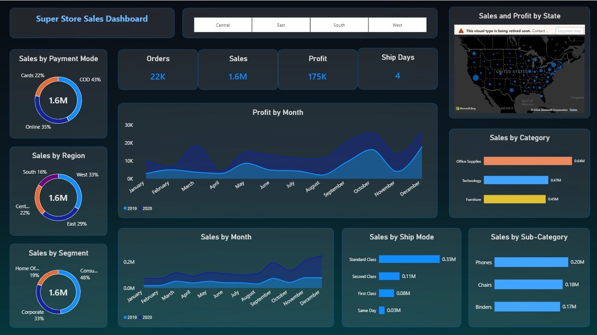

# Super Store Sales Analysis Dashboard

## Overview
An interactive sales dashboard developed using Microsoft Power BI to analyze sales performance, profitability, and order trends. The dashboard enables users to explore business performance across regions, product categories, customer segments, payment methods, and shipping modes.

## Dashboard Preview

## Key Features
- **KPI Analysis:** Tracks total sales, profit, order volume, and shipping days.
- **Sales Trend Analysis:** Visualizes monthly sales and profit trends.
- **Regional Analysis:** Examines sales distribution across different regions.
- **Product Analysis:** Analyzes sales by product category and sub-category.
- **Customer Segmentation:** Compares sales across customer segments.
- **Shipping Analysis:** Evaluates sales across different shipping modes.
- **Payment Analysis:** Examines sales distribution by payment method.
- **Interactive Filtering:** Enables region-based exploration of sales performance.

## Tools & Technologies
- Microsoft Power BI
- Microsoft Excel
- Data Visualization
- Business Intelligence

## Repository Contents
- `Sales.pbix` — Power BI report file.
- `SuperStore Sales DataSet.xlsx` — Source dataset.
- `dashboard.png` — Dashboard screenshot.

## How to Use
1. Clone or download this repository.
2. Open `Sales.pbix` in Microsoft Power BI Desktop.
3. If prompted, update the source file path to the location of the Excel dataset.
4. Refresh the data if required to explore the dashboard.

## Objective
To transform sales data into meaningful visual insights that support business performance analysis and informed decision-making.
